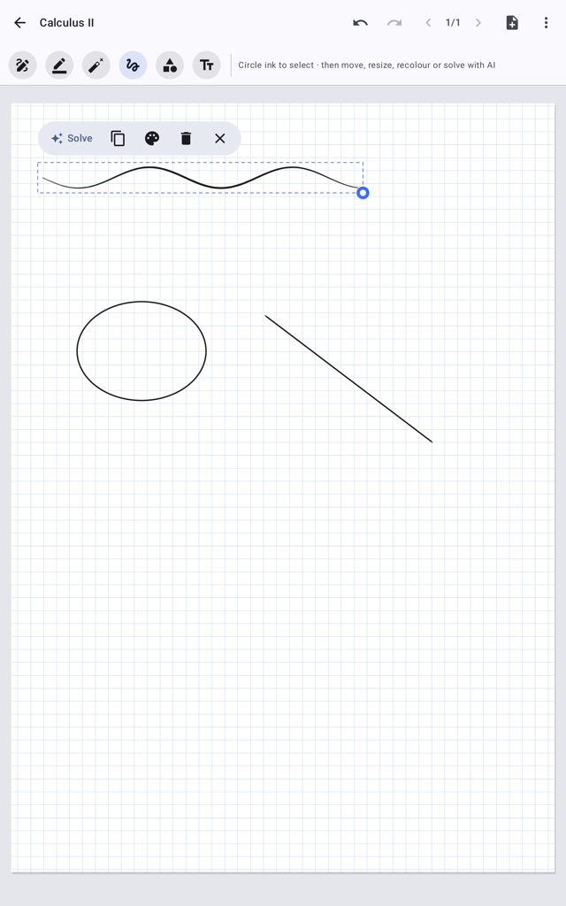
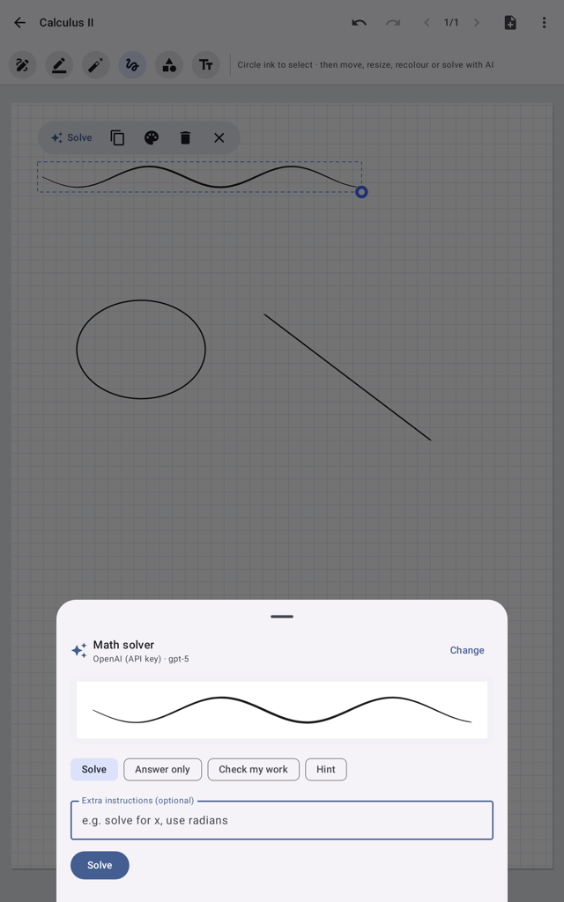
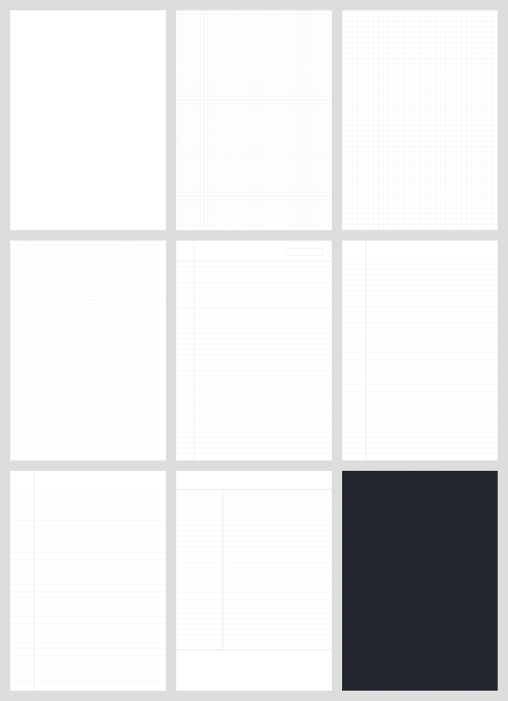

# Adv Notes

A notebook-style handwriting app for Android, built for the S Pen, with an AI math solver.

<p>



</p>

## Features

**Writing**
- Pressure-sensitive pen (S Pen / any active stylus) with an adjustable pressure curve. Strokes are smoothed, variable-width outlines.
- Highlighter that sits *under* the ink, with an optional "always straight" mode.
- Hold to snap: draw a line or shape and keep the pen still for a moment. It turns into a straight line (snapping to 0°/45°/90°), a circle/ellipse, a rectangle, a triangle or a polygon. You can keep moving a snapped line's end point before lifting.
- Shape tool: line, arrow, rectangle, ellipse, triangle, right triangle, diamond, coordinate axes.
- Eraser: whole-stroke or partial. The S Pen side button (configurable) gives a temporary eraser or lasso, and a pen's eraser end works too.
- Lasso: select ink and text, then move, resize (corner handle), duplicate, recolour, delete or **Solve**.
- Text boxes; undo/redo; pinch to zoom, two fingers to pan, double-tap to fit.
- Palm rejection: in *Auto* mode fingers draw until a pen is seen, after which fingers only scroll and zoom.

**Notebooks**
- Paper styles: Plain, Narrow grid (5 mm), Grid (7 mm), Dotted, **Oxford** (7 mm ruling, header band, red margin), College ruled, Wide ruled, Cornell, Isometric. Paper colours: white, cream, mint and dark. You can set the style per notebook or per page.
- Multiple pages, PDF export / share.



**AI math solver.** Lasso some handwriting, tap **Solve**, then choose *Solve*, *Answer only*, *Check my work* or *Hint*. The answer streams in and can be written onto the page next to your work.

| Provider | Notes |
|---|---|
| OpenAI (API key) | Chat Completions with image input. Default `gpt-5`. |
| ChatGPT subscription | "Sign in with ChatGPT" via the same OAuth flow as the open-source Codex CLI, using the Codex backend. **Unofficial**, so it may break if OpenAI changes it. |
| Anthropic (API key) | Messages API, default `claude-opus-5-5`, with server-side refusal fallback enabled for models that support it. |
| OpenRouter | Any vision model. |
| Custom OpenAI-compatible | LM Studio, Ollama, llama.cpp server, vLLM, LiteLLM… (base URL + optional key) |
| Custom Anthropic-compatible | Any `/v1/messages` server. |
| On-device (llama.cpp) | Runs a vision model fully offline through llama.cpp + libmtmd (JNI, arm64). One-tap downloads for Qwen2.5-VL-3B, Gemma-3-4B and SmolVLM2-2.2B, or import your own GGUF + mmproj. |

Each provider has a ↻ button that loads its model list, plus a *Test connection* button. API keys and tokens are stored in EncryptedSharedPreferences (Android Keystore).

**Google Drive sync.** Notebooks sync two-way with an "Adv Notes" folder in your Drive, using the narrow `drive.file` scope. Sync runs automatically every hour and after you close a notebook. If a notebook was edited on two devices, you get a "(conflict copy)" instead of losing edits. Local deletions propagate.

## Building

Requirements: JDK 17+, Android SDK 35, and for the on-device runner NDK `27.2.12479018` + CMake `3.22.1`.

```bash
git clone --recursive <repo>      # llama.cpp is a submodule
./gradlew assembleRelease         # app/build/outputs/apk/release/app-release.apk
```

- Without the submodule, or with `advnotes.llama=false` in `gradle.properties`, the app builds without the native runner (faster, smaller). The on-device option then shows as unavailable.
- The release build is signed with the debug key so it installs directly. Add your own signing config before publishing.
- CI (`.github/workflows/build.yml`) runs the unit tests and uploads the release APK as an artifact on every push.

### Google Drive setup (one-time, needed for sync)

Google only issues Drive tokens to registered apps:

1. In Google Cloud Console, create a project and enable the **Google Drive API**.
2. Configure the OAuth consent screen (External, add yourself as a test user) and add the scope `.../auth/drive.file`.
3. Create an OAuth client ID of type **Android** with package `com.advnotes.app` and the SHA-1 of the key that signs your APK (`./gradlew signingReport`; debug key by default).
4. Install the APK signed with that key. *Settings → Connect Google Drive* will then work. No client ID goes into the code.

## Tests

```bash
./gradlew :app:testDebugUnitTest
```

- `InkLogicTest`: shape recognition, partial eraser, lasso hit-testing, JSON round-trip.
- `RenderSnapshots` / `UiSnapshots`: Robolectric (native graphics) runs that drive the real UI with simulated S Pen events (pressure, side button, hold-to-snap, lasso) and write screenshots to `app/build/snapshots/`.

## Project layout

```
app/src/main/java/com/advnotes/app/
  ink/      InkCanvasView (input, tools, viewport), StrokeRenderer, PaperRenderer, Shapes, Geometry
  editor/   EditorScreen + EditorViewModel (undo/redo, pages, AI sheet)
  ai/       provider clients (SSE streaming), ChatGPT OAuth, llama.cpp bridge, model downloads
  sync/     Google Drive two-way sync + WorkManager job
  data/     JSON notebook storage, settings / encrypted secrets
  ui/       library, settings, theme
app/src/main/cpp/  llama_jni.cpp + CMake (llama.cpp submodule)
```
