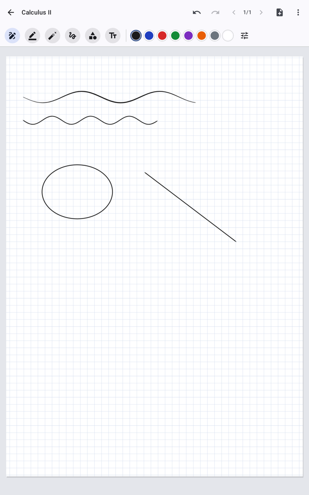
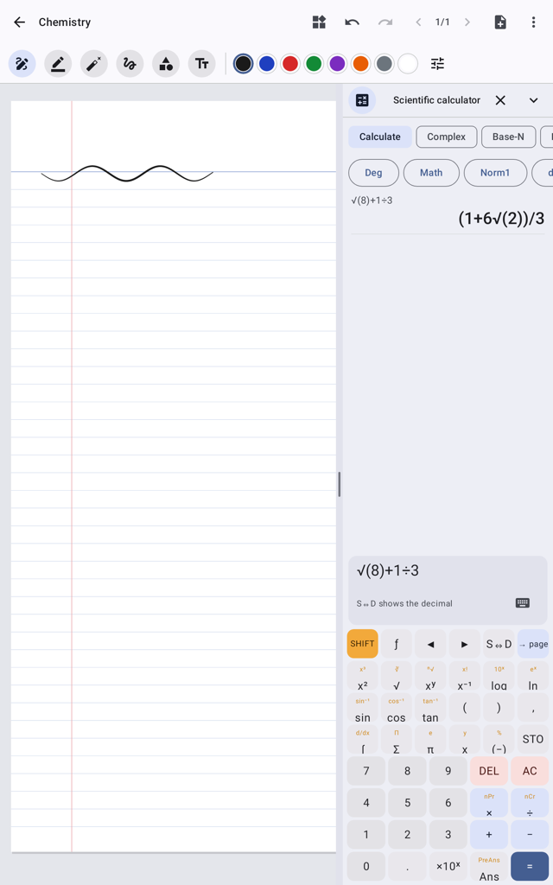
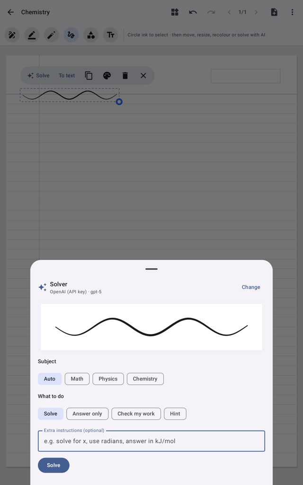
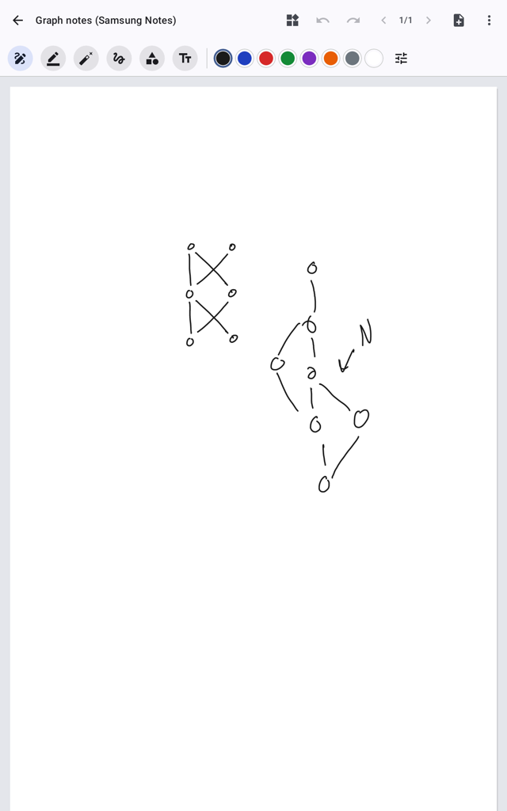
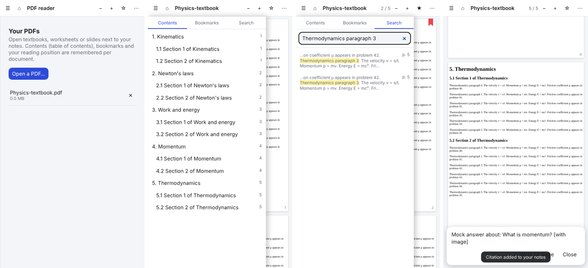

# Adv Notes

A notebook-style handwriting app for Android, built for the S Pen. It has an AI solver for math, physics and chemistry, handwriting-to-text, imports from other note apps, and a side panel of tools (scientific calculator, PDF reader, AI chat) that anyone can extend.

<p>



</p>

## Features

**Writing**
- Pressure-sensitive pen (S Pen / any active stylus) with an adjustable pressure curve. Strokes are smoothed, variable-width outlines.
- Highlighter that sits *under* the ink, with an optional "always straight" mode.
- Hold to snap: draw a line or shape and keep the pen still for a moment. It turns into a straight line (snapping to 0°/45°/90°), a circle/ellipse, a rectangle, a triangle or a polygon. You can keep moving a snapped line's end point before lifting.
- Shape tool: line, arrow, rectangle, ellipse, triangle, right triangle, diamond, coordinate axes.
- Eraser: whole-stroke or partial. The S Pen side button (configurable) gives a temporary eraser or lasso, and a pen's eraser end works too.
- Lasso: select ink and text, then move, resize (corner handle), duplicate, recolour, delete or **Solve**.
- Text boxes; undo/redo; pinch to zoom, two fingers to pan, double-tap to fit.
- Palm rejection: in *Auto* mode fingers draw until a pen is seen, after which fingers only scroll and zoom.
- Movable toolbar: drag its ⠿ handle to the top, bottom, left or right edge (icons stay centred). The tools panel can sit left or right of the page: drag or tap its handle.

**Notebooks**
- Paper styles: Plain, Narrow grid (5 mm), Grid (7 mm), Dotted, **Oxford** (7 mm ruling, header band, red margin), College ruled, Wide ruled, Cornell, Isometric. Paper colours: white, cream, mint and dark. You can set the style per notebook or per page.
- Multiple pages, PDF export / share.

**Import from other apps** (library ⇪ button, or *Insert pages from file…* inside a notebook)
- **Samsung Notes** `.sdocx`: handwriting comes in as real, editable strokes (Share → *Samsung Notes file* in Samsung Notes). The format is undocumented; the decoder follows the reverse-engineered description in [bxff/samsung-notes-format](https://github.com/bxff/samsung-notes-format) (MIT). Only stroke shapes are known, so pen colours/widths come in as defaults, and typed text and images are skipped. Export to PDF from Samsung Notes if you need those.
- **PDF** (also how GoodNotes, Notability, OneNote and Samsung Notes export): every page becomes a page you can write on. Circle printed text with the lasso and *Solve* or *To text* works on it.
- **Images** (PNG/JPEG/WebP; pick several for several pages).
- **Xournal++** `.xopp`: strokes with pressure, highlighter, text and paper style.

Imported PDFs and images sync to Google Drive with the notebook.


**AI solver (math, physics, chemistry).** Lasso some handwriting or part of an imported worksheet and tap **Solve**. Pick a subject (*Auto* detects it) and *Solve*, *Answer only*, *Check my work* or *Hint*. Physics answers list givens with SI units and carry units through; chemistry answers balance equations and show the mole working. The answer streams in and can be written onto the page next to your work.

**Handwriting to text.** Lasso → **To text**, choose the language (27, including Polish). Recognition runs on-device from your pen strokes with Google ML Kit Digital Ink (works offline after a one-time model download per language), or through your AI provider (auto-detects the language and also reads printed text). Then replace the ink with typed text, keep both, or copy.

**Tools side panel** (▦ in the editor): small apps next to your notes. On tablets they sit beside the page (drag the divider to resize); on phones they open over the bottom half. Several can stay open as tabs.
- **Scientific calculator.** The C++ engine of [moondotgz/casio](https://github.com/moondotgz/casio) (fx-991CEX feature set), compiled for Android through a small Qt-compatibility layer; the engine's own test suite passes unchanged. Exact fractions, √ and π, ∫, d/dx, Σ/Π, 47 constants, 40 unit conversions, STO/RCL variables, complex and base-N modes, polynomial and linear-system solvers, and statistics with 7 regressions. Long-press any result to write it on the page.
- **PDF reader** (pdf.js): a library of your PDFs, table of contents from the document outline, bookmarks named after their section, full-text search, remembered position, *Cite this page* into your notes, and *Summarise / Explain / Ask about this page* with AI.
- **AI chat** for everything else: explanations, essays, translation, quizzes, flashcards. It can look at your lasso selection or the visible page, and conversations are kept.
- **Build your own:** web tools are a folder with `manifest.json` + HTML/JS, installed from a `.zip` in *Settings → Tools*; most web apps port without changes. Native tools are a Kotlin interface. See **[docs/TOOLS.md](docs/TOOLS.md)** and the example in [`docs/tool-template`](docs/tool-template).

<p>



</p>


| Provider | Notes |
|---|---|
| OpenAI (API key) | Chat Completions with image input. Default `gpt-5`. |
| ChatGPT subscription (**unofficial**) | A workaround: it signs in as the open-source Codex CLI (same OAuth client and headers) and uses the Codex backend. This is **not** OpenAI's approved "Sign in with ChatGPT" partner program, so it may stop working at any time and you use it at your own account's risk. Claude Pro/Max login is deliberately not offered: Anthropic's terms forbid using it in third-party apps and it is enforced, so use an Anthropic API key. |
| Anthropic (API key) | Messages API, default `claude-opus-5-5`, with server-side refusal fallback enabled for models that support it. |
| OpenRouter | Any vision model. |
| Custom OpenAI-compatible | LM Studio, Ollama, llama.cpp server, vLLM, LiteLLM… (base URL + optional key) |
| Custom Anthropic-compatible | Any `/v1/messages` server. |
| On-device (llama.cpp) | Runs a vision model fully offline through llama.cpp + libmtmd (JNI, arm64). One-tap downloads for Qwen2.5-VL-3B, Gemma-3-4B and SmolVLM2-2.2B, or import your own GGUF + mmproj. |

Each provider has a ↻ button that loads its model list, plus a *Test connection* button. API keys and tokens are stored in EncryptedSharedPreferences (Android Keystore).

**Google Drive sync.** Notebooks sync two-way with an "Adv Notes" folder in your Drive, using the narrow `drive.file` scope. Sync runs automatically every hour and after you close a notebook. If a notebook was edited on two devices, you get a "(conflict copy)" instead of losing edits. Local deletions propagate.

## Building

Requirements: JDK 17+, Android SDK 35, and for the on-device runner NDK `27.2.12479018` + CMake `3.22.1`.

```bash
git clone --recursive <repo>      # llama.cpp and the casio calculator engine are submodules
./gradlew assembleRelease         # app/build/outputs/apk/release/app-release.apk
```

- Without the submodule, or with `advnotes.llama=false` in `gradle.properties`, the app builds without the native runner (faster, smaller). The on-device option then shows as unavailable.
- The release build is signed with the debug key so it installs directly. Add your own signing config before publishing.
- CI (`.github/workflows/build.yml`) runs the unit tests and uploads the release APK as an artifact on every push.

### Google Drive setup (one-time, needed for sync)

Google only issues Drive tokens to registered apps:

1. In Google Cloud Console, create a project and enable the **Google Drive API**.
2. Configure the OAuth consent screen (External, add yourself as a test user) and add the scope `.../auth/drive.file`.
3. Create an OAuth client ID of type **Android** with package `com.advnotes.app` and the SHA-1 of the key that signs your APK (`./gradlew signingReport`; debug key by default).
4. Install the APK signed with that key. *Settings → Connect Google Drive* will then work. No client ID goes into the code.

## Tests

```bash
./gradlew :app:testDebugUnitTest
```

- `InkLogicTest`: shape recognition, partial eraser, lasso hit-testing, JSON round-trip.
- `ImportTest`: Samsung Notes and Xournal++ import on real sample files, format detection.
- `HandwritingTest`: line grouping for recognition, subject prompts.
- `CalculatorEngineTest`: the C++ calculator engine through the real JNI bridge (built for the host by the `buildHostCasio` task; needs `g++`).
- `RenderSnapshots` / `UiSnapshots`: Robolectric (native graphics) runs that drive the real UI with simulated S Pen events (pressure, side button, hold-to-snap, lasso), open the tools panel and use the calculator, and write screenshots to `app/build/snapshots/`.

The calculator engine's own suite also runs against the compatibility layer on a desktop: `g++ -std=c++20 -Iapp/src/main/cpp/casio_shim -Iapp/src/main/cpp/casio/src -Iapp/src/main/cpp/casio/src/core app/src/main/cpp/casio/src/core/*.cpp app/src/main/cpp/casio/tests/test_core.cpp && ./a.out` (124/124 pass).

## Project layout

```
app/src/main/java/com/advnotes/app/
  ink/      InkCanvasView (input, tools, viewport), StrokeRenderer, PaperRenderer, Shapes, Geometry
  editor/   EditorScreen + EditorViewModel (undo/redo, pages, AI sheet)
  ai/       provider clients (SSE streaming), ChatGPT OAuth, llama.cpp bridge, model downloads
  sync/     Google Drive two-way sync (notebooks + imported files) + WorkManager job
  importer/ PDF, image, Samsung Notes (.sdocx) and Xournal++ (.xopp) import
  tools/    side panel, tool framework (native + web tools, JS bridge), calculator, AI chat
  data/     JSON notebook storage, settings / encrypted secrets
  ui/       library, settings, theme
app/src/main/assets/tools/   bundled web tools (PDF reader with pdf.js) and the AdvNotes JS API
app/src/main/cpp/
  llama_jni.cpp           on-device LLM bridge (llama.cpp submodule)
  casio/                  calculator engine (moondotgz/casio submodule)
  casio_shim/             Qt-compatibility layer so the engine builds without Qt
  casio_bridge/           JSON API + JNI for the calculator
```

## Third-party code

llama.cpp (MIT), pdf.js (Apache-2.0, bundled in `assets/tools/pdfreader/pdfjs`), Google ML Kit Digital Ink Recognition, and the Samsung Notes format description from bxff/samsung-notes-format (MIT; two of its sample notes are used as test fixtures).
